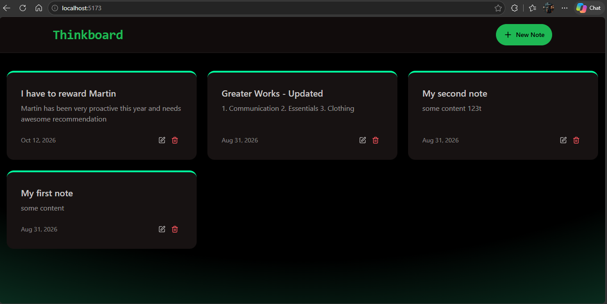
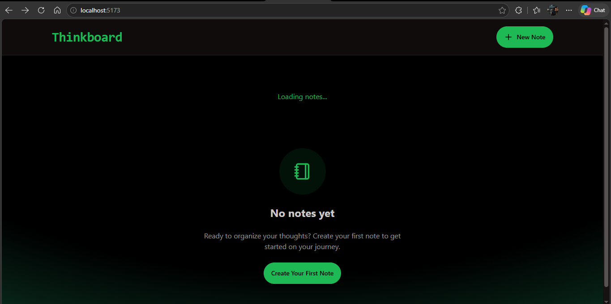
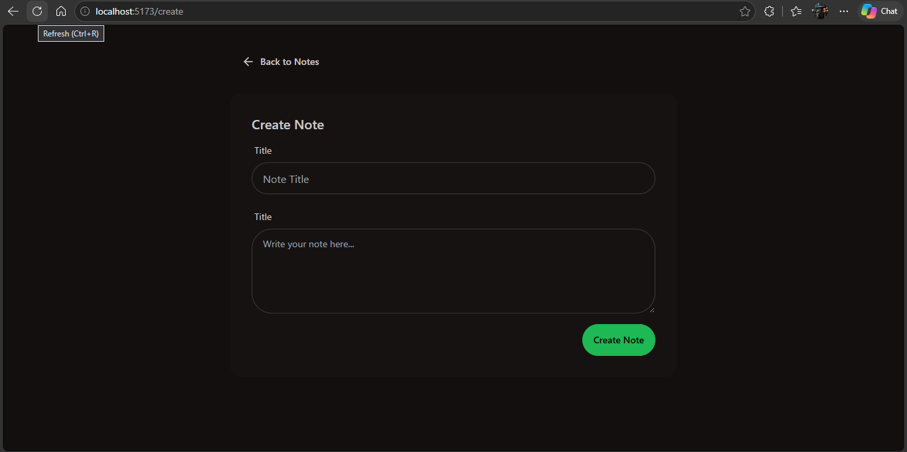
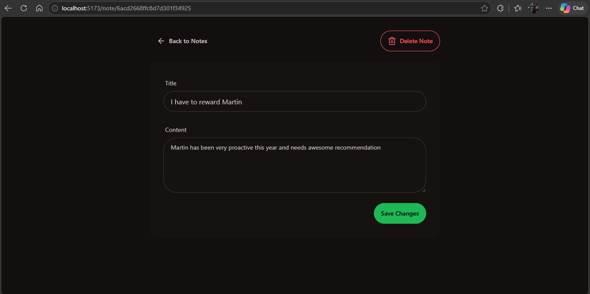

```markdown
# ThinkBoard

ThinkBoard is a notes app built with MongoDB, Express, React, and Node.js (the MERN stack). MongoDB stores notes, the Express API handles note operations, and React is set up to display the application. The backend uses Upstash Redis to limit requests.

> **Current state:** The backend CRUD API and frontend route declarations are present. The page and UI component source files are now present in this checkout, so the browser interface has been implemented. Screenshots below show the intended UI.

## Contents

- [Requirements](#requirements)
- [Setup](#setup)
- [Run locally](#run-locally)
- [API](#api)
- [Project structure](#project-structure)
- [Scripts](#scripts)
- [Screenshots](#screenshots)

## Requirements

- Node.js and npm
- A MongoDB database, local or MongoDB Atlas
- An Upstash Redis database with REST credentials

## Setup

Install dependencies from the project root:

```bash
npm install --prefix backend
npm install --prefix frontend
```

Create `backend/.env` with your service credentials:

```dotenv
MONGO_URI=mongodb+srv://<username>:<password>@<cluster>/<database>?retryWrites=true&w=majority
UPSTASH_REDIS_REST_URL=https://<your-database>.upstash.io
UPSTASH_REDIS_REST_TOKEN=<your-token>
PORT=5001
```

`MONGO_URI` is the variable the backend reads; `MONGODB_URI` and `DATABASE_NAME` from the previous instructions are not used. The MongoDB database name can be included in the connection string. Keep `.env` private; it is ignored by Git.

## Run locally

Open two terminals at the project root. In the first, start the backend:

```bash
cd backend
npm run dev
```

In the second, start the frontend:

```bash
cd frontend
npm run dev
```

Vite serves the site at `http://localhost:5173`; Express listens at `http://localhost:5001`. In development, the frontend's Axios client sends API requests to `http://localhost:5001/api`, and the server allows the Vite origin through CORS.

## API

All endpoints start with `/api/notes`. Send JSON with `title` and `content` for create and update operations.

| Method | Path | Purpose | Success |
| --- | --- | --- | --- |
| `GET` | `/api/notes` | List notes, newest first | `200` and an array |
| `GET` | `/api/notes/:id` | Get one note by MongoDB ID | `200` and a note; `404` if missing |
| `POST` | `/api/notes` | Create a note | `201` and the saved note |
| `PUT` | `/api/notes/:id` | Update a note's title and content | `200` and the updated note; `404` if missing |
| `DELETE` | `/api/notes/:id` | Delete a note | `200` and a confirmation message |

Example request:

```http
POST /api/notes
Content-Type: application/json

{
  "title": "A thought",
  "content": "Write it down before I forget."
}
```

Each note has `title`, `content`, `createdAt`, and `updatedAt` fields. The rate limiter allows 100 requests per 60 seconds and responds with `429` when the limit is exceeded. It currently uses a shared key for all callers.

## Project structure

```text
.
├── backend/
│   └── src/
│       ├── config/          # MongoDB and Upstash configuration
│       ├── controllers/     # Note CRUD request handlers
│       ├── middleware/      # Rate limiting
│       ├── models/          # Mongoose Note schema and model
│       ├── routes/          # Express API route definitions
│       └── server.js        # Backend entry point
├── frontend/
│   ├── public/              # Static assets
│   └── src/
│       ├── components/      # Reusable UI components (currently empty)
│       ├── lib/             # Shared Axios client
│       ├── pages/           # Home, create, and note detail routes (currently empty)
│       ├── App.jsx          # Route declarations
│       └── main.jsx         # React entry point
├── screenshots/             # Reference screenshots
└── package.json             # Root build and start scripts
```

## Scripts

| Where | Command | What it does |
| --- | --- | --- |
| `backend/` | `npm run dev` | Run the API with Nodemon for automatic restarts |
| `backend/` | `npm start` | Run the API with Node.js |
| `frontend/` | `npm run dev` | Run the Vite development server |
| `frontend/` | `npm run build` | Build frontend assets into `frontend/dist` |
| `frontend/` | `npm run preview` | Preview the production frontend build |
| `frontend/` | `npm run lint` | Run ESLint on the frontend |
| root | `npm run build` | Install both apps' dependencies and build the frontend |
| root | `npm start` | Start the backend server |

For a combined production deployment, run `npm run build`, set `NODE_ENV=production`, then run `npm start`. The backend serves the built frontend from `frontend/dist` in production mode.

## Screenshots

These images are reference screenshots of the intended interface.

### Homepage



### No notes or loading



### New note



### Edit note


```
